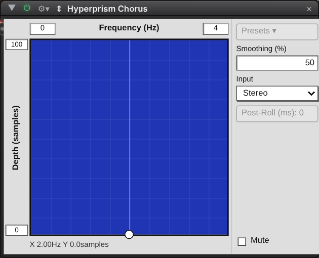
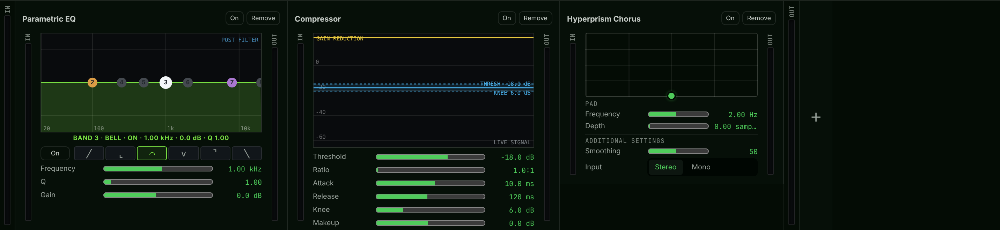

# prism-fx


Audio effects and a sound engine written once, for two programs:
**MultiGrainLive** (native Rust) and **idMLab** in M Clone (Rust compiled to
wasm32 in an AudioWorklet). Both depend on this repository by path.

The design is in MultiGrainLive's `docs/SHARED-FX.md`. The effects come from
its `docs/HYPERPRISM.md` and `docs/EFFECT-INTAKE.md`.

## Crates

- **`prism-fx`** — the effects. `CATALOG` holds 86:
  - Tremolo, Decimator, Echo, Multi Delay, Stereo Matrix, Spectral Dynamics
    and Convolution;
  - nine SoundHack plug-ins (`sh_*`) and four Lexicon LXP reverbs (`lxp_*`);
  - 29 Hyperprism effects (`hp_*`, codes 32–64);
  - the 37 of MultiGrainLive's own (codes 65–101): its 33 shape kinds, its
    rack EQ, compressor, gain and channel maximizer. MultiGrainLive's rack now
    builds all of them from here, held bit for bit to its own renders.
- **`prism-grain`** — MultiGrainLive's sound engine, moved here unchanged:
  grains, WSOLA, phase vocoder, PVSOLA and hybrid streamers, the `Stretcher`
  and the `BlockRenderer`. idMLab runs it as its Grain Engine.

## In the hosts

Each host draws an effect's panel from its `Descriptor`: the same controls,
groups and pad in both.



*idMLab: Hyperprism Chorus as a module.*



*MultiGrainLive: the same effect in the rack, after its EQ and compressor —
both of which are prism-fx effects too.*

## The effect contract

- Every effect is a `Kernel`: stereo, in place, one frame at a time, with a
  block method that must give the same output. `prism_fx::make(id, rate)`
  builds one as a `Box<dyn DynKernel>`.
- A kernel may also take a sound (`set_sound`, a convolution's impulse),
  report latency, run one channel its own way (`has_mono` / `tick_mono`, as
  MultiGrainLive's mono files need) and report a meter value (`telemetry`, the
  compressor's gain reduction).
- Every effect has a `Descriptor`: id, wire code, parameters and its shared
  panel. Both hosts read that one table, so a range cannot drift between
  them. Ids and codes are never reused; parameters are only appended.
- `contract` holds the rules every effect keeps, and the tests run them over
  the whole `CATALOG`: frames match blocks, block size does not matter, every
  control reaches the output, the output stays finite, reset is a fresh start,
  and nothing allocates after `new`. Effects ported from MultiGrainLive are
  also held to golden renders of the originals (`tests/fixtures`).

No outside crates. `prism-fx` forbids `unsafe`; `prism-grain` uses none.

```
cargo test
cargo build --target wasm32-unknown-unknown --release
```

`echo_parity` fails on Linux at present: one of its recorded values does not
match there.
